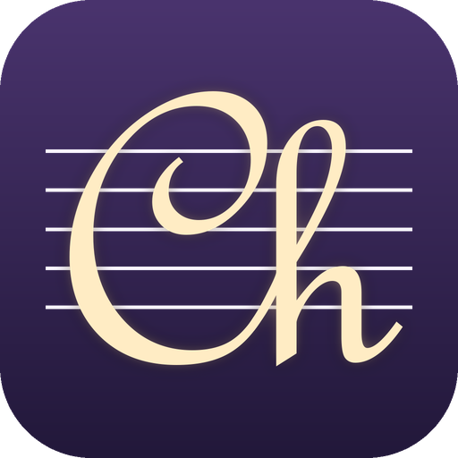

# ChorDAW

*Chord + DAW. Working name; the repository is still called rust-audio-composer.*

A native desktop Digital Audio Workstation (DAW) written in Rust. Make beats with expressive, velocity-sensitive instruments for trap, hip hop, drum & bass, UK garage and classical. Record multi-track compositions, design your own sounds by describing them, and **play it all wirelessly from your iPhone or iPad**.

Everything runs locally on your computer: no cloud, no account, and your projects stay on your disk.

## Running locally

### 1. Install Rust (one time)

| OS | Steps |
|----|-------|
| **Windows** | Install [rustup](https://rustup.rs) (`winget install Rustlang.Rustup`). Pick **one** toolchain: the default MSVC one needs [Visual Studio Build Tools](https://visualstudio.microsoft.com/visual-cpp-build-tools/) with "Desktop development with C++"; the GNU one needs MinGW-w64 (e.g. `winget install BrechtSanders.WinLibs.POSIX.UCRT`) and then `rustup default stable-x86_64-pc-windows-gnu`. |
| **macOS** | `xcode-select --install`, then `curl https://sh.rustup.rs -sSf \| sh` |
| **Linux** | `curl https://sh.rustup.rs -sSf \| sh` plus ALSA/X11 dev packages (Debian/Ubuntu: `sudo apt install build-essential pkg-config libasound2-dev libx11-dev libxkbcommon-dev libgl1-mesa-dev`) |

Check it worked:

```bash
cargo --version
```

> **Low on space on your system drive?** The toolchain and build cache take a few GB. Set `CARGO_HOME` and `RUSTUP_HOME` to a folder on another drive *before* installing (or move them and update the variables).

### 2. Build and run

```bash
git clone https://github.com/s1j1k/rust-audio-composer.git
cd rust-audio-composer
cargo run --release
```

- The **first build takes a few minutes** (GPU, audio and networking libraries). Later builds take seconds.
- Use `--release` when playing: the audio engine runs much faster than in a debug build. Plain `cargo run` is fine while developing.
- On first launch the app downloads its free CC0 instrument samples in the background and caches them in `~/rust-audio-composer/` (`C:\Users\<you>\rust-audio-composer\` on Windows). It works offline too, using synthesized fallbacks until the downloads finish.
- You need a working audio output (speakers or headphones).

### 3. Run the tests

```bash
cargo test
```

## Play from your iPhone or iPad (📱 Remote)

Turn a phone or tablet into a wireless, touch-sensitive keyboard for the app on your computer.

1. Put the phone and computer on the **same Wi-Fi** (5 GHz is best; the computer can be on Ethernet).
2. In the desktop app click **📱 Remote**. The first time, Windows asks about network access: allow **Private networks**.
3. **Scan the QR code** with the iPhone camera (or type the `http://…:7878/` address into Safari).
4. Optional: tap Share → **Add to Home Screen** for a full-screen app, and play in landscape.

Tip: `cargo run --release -- --remote` starts the remote keyboard as soon as the app opens.

What you get:
- **Real-time playing.** Notes go straight from the network into the audio engine without waiting for the screen to redraw. The phone shows live latency (green = under 15 ms one-way).
- **Touch sensitivity:**
  - **Where you strike** the key sets velocity (lower on the key = louder).
  - **Slide on a held key** for pressure/expression: the sound opens up, swells and gains vibrato.
  - **Slide across keys** for glissando.
  - **3D Touch iPhones and Apple Pencil** add real pressure.
  - **Tap strength**, optional: uses the accelerometer to feel how hard you hit (see below).
- **Sustain pedal** strip, octave and zoom controls, and an instrument picker synced with the selected track. Velocity curves (Soft / Natural / Hard / Fixed) are set on either device.
- **Record from the phone.** Tap **REC** on the phone (or ⏺ Record on the desktop): one bar of count-in, then your playing is recorded onto the selected track. Tap **STOP** to finish. Notes appear live in the timeline bubble and the piano roll as you play.
- **Chain several devices into one long keyboard.** Tick *Chain devices* in the Remote window, put the devices in left-to-right order with ◀ ▶ (use **Flash** to tell them apart), and keys continue from one screen to the next, sized for the smallest screen.
- **Safe disconnects.** If a phone locks or drops off Wi-Fi, its notes are released automatically, so nothing gets stuck.

**Tap-strength velocity (HTTPS, optional).** iOS only shares the accelerometer with secure pages, so the app also serves HTTPS on port 7879 using a certificate authority it creates on your computer. One-time setup is shown in the Remote window: open `http://<computer-ip>:7878/ca.crt` on the phone, install the profile, enable it under *Settings → General → About → Certificate Trust Settings*, then use the `https://…:7879/` address and turn on **⚙ → Enable tap strength**.

Why local Wi-Fi instead of the internet? Same-room Wi-Fi is a few milliseconds. A round trip through a cloud server is typically 20–80 ms and jittery, and stops working when the internet does.

## Features

### Instruments for beat-making

**Genre presets (synthesized in real time, no downloads).** Velocity changes tone as well as volume, and pressure from a phone or mouse drag opens the sound up.

| Genre | Melodic | Drum kit |
|-------|---------|----------|
| Trap | 808 Bass (pitch drop + saturation), Trap Bell (FM), Dark Pluck | Trap 808 Kit |
| Hip Hop | Dusty Rhodes (FM electric piano with velocity "bark"), Boom Bap Bass | Boom Bap Kit (lo-fi processed) |
| Drum & Bass | Reese Bass (detuned, moving filter), Sub Bass, Liquid Pad | D&B / Jungle Kit |
| UK Garage | Garage Organ stab, 2-Step Chord Stab, Garage Bass | UK Garage Kit |
| Classical | Chamber Strings (bowed swell + vibrato), Pizzicato, **Piano**, **Concert Harp** | — |

**Sampled instruments (free CC0 recordings).**

| Instrument | Source | Velocity layers |
|------------|--------|-----------------|
| Piano | FreePats Upright Piano KW | **Soft + hard recordings**, 15 zones |
| Concert Harp | VCSL (Versilian Community Sample Library) | **mf + f recordings**, 7 zones |
| Guitar, Bass, Strings, Flute, Brass, Organ, Pad | FreePats | single sample, velocity-tracked tone |
| Drums | FreePats Synthesizer Percussion | velocity-tracked tone |

Drum tracks only take drum kits and melodic tracks only take melodic instruments, so changing the sound never turns a beat into random pitches. To use both, add one track of each kind.

Multi-velocity instruments crossfade between real soft and hard recordings, so soft playing sounds genuinely softer (rounder, darker), not just quieter. These download once in the background. See [CREDITS.md](CREDITS.md).

Drum kits play from the General MIDI drum map *and* from any octave (C = kick, D = snare, F♯ = closed hat, A♯ = open hat…), so they work from a phone. Closed hats choke open hats.

### Instrument Library (more instruments from single-note samples)

Open **View → Instrument library**, or **Browse more instruments…** under the instrument picker. Instruments are built from **individual recorded notes only**: no loops or beat samples, so everything you make is played from scratch. Each note you add becomes a key, and the keys in between repitch the nearest note.

- **Freesound:** search the "Instrument samples" category for single notes (loops are filtered out). Preview with ▶, tick the notes you want, and **Add selected** to a new or existing instrument. **Pack** shows every sound in a Freesound pack, which is often all the notes of one recorded instrument. Each sample's note comes from Freesound's pitch analysis, the file name, or ChorDAW's own pitch detection.
  - Needs **your own free API key** from [freesound.org/apiv2/apply](https://freesound.org/apiv2/apply). Freesound doesn't allow apps to share one key, so it's not built in. Paste it into the Freesound tab; it's stored only on your computer (`~/rust-audio-composer/settings.json`).
  - Samples come from Freesound's high-quality previews (OGG ~192 kbps), which need only the key.
- **Import folder:** for packs you download yourself (soundpacks.com, VCSL, Philharmonia…). Choose the folder; notes are read from names like `Cello_A3.wav` or measured from the audio, and you can correct them (with an octave fix for packs that call middle C "C3").
- **Only sounds you may use in songs you release or sell can be added:** Creative Commons 0, Attribution (CC BY), or packs whose licence says they're royalty-free for music. NonCommercial and unknown licences are refused. Every sample keeps its title, author, licence and link, listed under **Credits** for each instrument; credit Attribution authors when you publish.
- Instruments are stored in `~/rust-audio-composer/instruments/` and appear in every instrument picker (including the phone's) under **Sample library**.

### ✨ Sound Designer (describe a timbre)
1. Describe the sound the way you'd tell a producer friend: *"dark gritty 808 with a long tail"*, *"dusty lofi rhodes, warm and a bit wobbly"*, *"lush cinematic strings that swell slowly"*.
2. As you type, **"I'm hearing:"** shows what it understood: the base instrument (genre-aware, so "trap bass" → 808 and "dnb bass" → Reese) and each trait.
3. **✨ Create sound** plays a short soft-then-hard preview so you hear the velocity response.
4. **Keep shaping it**, either with one-click chips (Warmer, Punchier, Longer tail, Wider, Grittier, Vintage…) or by typing follow-ups like *"a bit darker and less boomy"* or *"make it a harp instead"*. It understands intensity ("a bit", "very"), negation ("not too bright") and comparatives ("warmer"). There's undo, and sliders for fine-tuning.
5. **💾 Save to library.** Custom instruments appear in every instrument picker, including on your phone. **Remix** reloads one into the designer.

It runs entirely on your computer.

### Virtual Piano
- Opens in the **bottom panel** (🎹 Piano, or the *Virtual piano* tab next to Piano roll / Step sequencer); **Pop out** for a separate window, close it to dock it back
- Click lower on a key for louder; **drag down on a held key for pressure**
- Computer keyboard: **Z X C V B N M , . /** for white keys, **S D G H J** for black keys (letters are printed on the keys)
- Pressed keys animate like the phone keyboard: they sink and light up blue (deeper for harder hits); keys played from a phone light up green

### Beat Sequencer (Drums)
- Built into the main screen: select a drum track and the bottom panel shows the **step sequencer**; switch to **Drum roll** with one click, or **Pop out** the sequencer into its own window
- **16-step drum grid** with a drawn icon per drum (kick, snare, hi-hats, toms, clap, cymbal, shaker)
- Click to toggle a hit; **Shift+click** for accent (louder); **right-click** to remove
- Pick a genre kit for the drum track in the sidebar instrument menu
- Add drum tracks via **+ Drum Track** in the sidebar (or the **Drums** button, which adds one if needed)

### Velocity
- Notes store **velocity** (0–1), which controls level *and* tone on playback and export
- **Virtual piano:** click lower on a key = louder; **Shift** = accent, **Alt** = soft on keyboard
- **Phone/tablet:** strike position, pressure, optional tap strength (see above)
- **Velocity curve** setting (📱 Remote window) for light or heavy touch
- Recording captures velocity automatically

### DJ Tools (🎛 DJ)
Mix effects for the **master bus** and **each track**:
- **Distance / underwater:** muffled, far-away sound (auto low-pass + reverb)
- **Reverb:** space and depth
- **Phaser swirl:** phase movement (fade in/out character)
- **Brightness:** manual low-pass filter

Effects apply live on the master output; per-track effects apply fully on **WAV export** and partially during live playback.

### Timeline & Piano Roll

**Timeline (top)**, one row per track:
- Click a row to select that track
- **Snap to playhead:** dragged clips (and their trim and loop handles) stick to the playhead when they get close; hold Alt to drag freely, or untick "Snap to playhead". Right-click a clip → **Move to playhead** jumps the selection there
- **Move the playhead** by dragging the red ▼ handle in the ruler, the ▲ handle at the bottom, or the line itself (or click the ruler)
- Each clip ("bubble") shows a **mini piano roll** of its notes; looped repeats are drawn as dimmer copies

**Recording**
- **⏺ Record** while stopped gives a **one-bar count-in** (with clicks): the playhead rolls up to where you were and recording starts there. While playing, it punches in immediately.
- Recording **inside an existing bubble overdubs** into it; on empty space it starts a **new bubble**, so one track can hold many takes.
- Stop with the red **Stop recording** button, **Space**, or **STOP** on the phone.

**Piano Roll (bottom)**, the detailed editor for the selected track:
- Vertical piano keys on the left; keys you're holding light up (blue = mouse/keyboard, green = phone), along with their row
- **Click** the grid to write a note, like on a score: it goes into the clip at that spot (or extends the one just before it), or a new clip appears. New notes take the length of the last note you resized. Click the ruler to move the playhead
- **Chord names** run along the top of the grid, read from all your melodic tracks, and hovering shows the chord under the pointer with its notes and bass note. Hovering a bubble in the timeline does the same, so on a bass track you can see what chord you're playing under
- The keys look like a real keyboard on its side: low notes at the bottom, black keys shorter, octaves marked by a bold **C**
- **Scroll** over the roll to move up and down by semitones, or use **▼ Octave / ▲ Octave** in Track Controls. The view reaches the whole MIDI range, down to the deepest bass notes
- Notes being recorded grow in real time at the playhead, and the view scrolls to follow it
- Click the grid to place notes, or use the virtual piano / phone while recording

### Multi-Track, Transport, Composition
- Unlimited tracks; per-track volume, mute, instrument
- **Add tracks** with **+ Melodic track / + Drum track** just below the last track in the timeline
- **Delete a track** from Track Controls or by right-clicking its name in the timeline (a track with notes asks first)
- **Undo / Redo** with the transport buttons, **Ctrl+Z** and **Ctrl+Y** (or Ctrl+Shift+Z). Every edit is undoable: notes, clips, recordings (a whole take is one step), tracks, instruments, mixer settings and tempo. Moving the playhead isn't an edit
- **Clips:** Ctrl+click or Shift+click bubbles to select several. **Ctrl+C / Ctrl+V** copy and paste at the playhead, **Ctrl+D** duplicates right after, **Delete** (or Backspace) removes the selected clips, and **Merge** combines the selection into one clip (gaps and loop repeats included) that you can then loop as a whole. All of these are also in the bubble's right-click menu and in Track Controls
- Play / Pause / Stop / Record, BPM (40–240), time signature
- **🎼 Compose:**
  - **Key:** use the key detected from your melodic notes, or choose any key yourself (also by clicking the circle of fifths)
  - **Chord progressions:** click chords one at a time (each adds one bar at the playhead and moves on), or **Add all** to drop the whole progression in as one loopable clip
  - **Genre tips** for trap, hip hop, drum & bass, UK garage and classical: tempo range with a one-click **Set BPM**, arrangement, drum and harmony tips, and genre-flavoured progressions. Drum & bass figures follow [DnB Academy's BPM and structure guide](https://app.dnbacademy.net/learn/drum-and-bass-bpm-and-structure)
  - Interactive circle of fifths

### Save, Open & Export (File menu)
- **New project** (Ctrl+N), **Open project…** (Ctrl+O), **Save** (Ctrl+S, saves back to the same file), **Save as…** (Ctrl+Shift+S). Projects are `.rac.json` files and include your custom instruments
- **Export WAV…** (Ctrl+E) renders the full composition
- The window title shows the song name with `*` when there are unsaved changes; New and Open ask before discarding them
- **Edit** has undo/redo and the clip actions, **View** shows or hides each panel, **Help** opens the guide. Messages appear in the status bar at the bottom

### Quick tour

Open **Help → User guide** for the in-app guide.

| Button | What it does |
|--------|--------------|
| **🎹 Piano** | On-screen keyboard |
| **📱 Remote** | Play from iPhone/iPad over Wi-Fi |
| **⏺ Record** | Record what you play onto the selected track |
| **▶ Play** | Play back your composition |
| **🎼 Compose** | Key detection, chord suggestions, circle of fifths |
| **✨ Sound Designer** | Describe and shape your own instruments |
| **Drums** | Beat sequencer (bottom panel on drum tracks) |
| **DJ** | Mix effects |
| **View → Options…** | Interface font, interface size and help display |
| **Space** | Play / pause, or stop recording |

## Keyboard Shortcuts (Piano Window)

| Key | Note |
|-----|------|
| Z | C3 |
| S | C#3 |
| X | D3 |
| D | D#3 |
| C | E3 |
| V | F3 |
| G | G#3 |
| B | A3 |
| H | A#3 |
| N | B3 |
| M | C4 |
| J | C#4 |

## Architecture

```
 iPhone / iPad (Safari, no install)               Your computer (one Rust program)
 ┌──────────────────────────────┐   local Wi-Fi  ┌───────────────────────────────────────┐
 │ web keyboard served by the   │──WebSocket────▶│ network thread ──▶ audio engine ──▶ 🔊 │
 │ desktop app: touch → velocity│  (no internet) │        └──▶ UI (record, highlight)     │
 └──────────────────────────────┘                │ native GPU-rendered UI (egui)         │
                                                 └───────────────────────────────────────┘
```

- **The desktop UI is native Rust.** It's custom-drawn and GPU-accelerated (egui/wgpu), with no web view or Electron. That keeps startup fast, memory low and frame times steady while the audio runs.
- **Audio** goes through `cpal` (WASAPI on Windows, CoreAudio on macOS, ALSA on Linux). Voices are rendered sample by sample in Rust; there are no garbage-collection pauses to cause clicks.
- **Remote keyboard:** `tokio` + `axum` WebSocket server (with `TCP_NODELAY`), and optional HTTPS through `rustls` with a locally generated certificate. The phone client is plain HTML/JS compiled into the binary.

## Project Structure

```
src/
  main.rs                # Entry point
  app.rs                 # DAW state, playback, recording, remote event handling
  model/                 # Project, tracks, notes, instruments (genre presets, kits)
  audio/
    engine.rs            # Instrument routing, live input, velocity curves
    synth.rs             # Voices: sample playback (velocity layers), drums, sustain pedal
    genre_synth.rs       # Real-time synth presets (808, Reese, Rhodes, strings…)
    drum_kits.rs         # Synthesized genre drum kits
    multisample.rs       # Multi-zone, multi-velocity sampled instruments (background download)
    samples.rs           # Sample download/decode/cache
  remote/
    mod.rs               # LAN server: WebSocket → audio engine
    protocol.rs          # Message types, multi-device keyboard layout
    tls.rs               # Optional HTTPS (local certificate authority)
    web/                 # Phone/tablet client (HTML/CSS/JS, embedded)
  music/                 # Music theory: keys, chords, circle of fifths
  ai/                    # Natural-language timbre interpreter
  ui/                    # Transport, tracks, piano, piano roll, designer, remote panel…
```

## Roadmap / TODO

See [TODO.md](TODO.md). Highlights:
- Lower-latency audio (buffer-size setting, exclusive mode, lock-free note queue)
- MIDI in/out, so external keyboards work and phones can control other software
- Native iOS app with Bluetooth MIDI (playing without Wi-Fi)
- Undo/redo, MIDI file import/export

## Tech Stack

- **Rust** 2021 edition
- **eframe / egui** for the native, GPU-accelerated desktop UI
- **cpal** for cross-platform audio I/O
- **tokio / axum / rustls / rcgen** for the local-network remote keyboard
- **hound / claxon** for WAV and FLAC decoding
- **serde** for project files and the wire protocol
